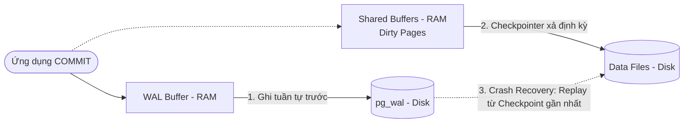

# Write-Ahead Log (WAL)

!!! abstract "Nguyên lý cốt lõi"
    Mọi thay đổi dữ liệu đều phải được ghi tuần tự vào nhật ký **WAL** (`pg_wal`) trên ổ cứng **trước khi** các trang dữ liệu thực tế trong RAM (`shared_buffers`) được ghi đè xuống bảng. Cơ chế này biến Random I/O thành Sequential I/O và đảm bảo tính **Durability**.

## 1. Luồng xử lý & Crash Recovery

1. **WAL Buffer -> `pg_wal`:** Giao dịch ghi thay đổi vào WAL Buffer, sau đó tiến trình **WAL Writer** (hoặc backend khi `COMMIT`) xả tuần tự xuống các segment 16MB trong `pg_wal`.
2. **Checkpoint:** Tiến trình **Checkpointer** định kỳ xả các *Dirty Pages* từ `shared_buffers` xuống file bảng trên đĩa và ghi dấu mốc Checkpoint vào WAL.
3. **Crash Recovery:** Khi khởi động lại sau sự cố mất điện, PostgreSQL đọc từ mốc **Checkpoint gần nhất** và chạy lại (*replay*) toàn bộ bản ghi WAL để khôi phục dữ liệu đã `COMMIT`.



## 2. Tinh chỉnh & Vận hành Thực chiến

| Tham số / Khái niệm | Vai trò & Khuyến nghị Production |
| :--- | :--- |
| **`fsync = on`** | Ép OS xả dữ liệu xuống đĩa vật lý. **Bắt buộc giữ `on`** để tránh hỏng DB khi mất điện. |
| **`synchronous_commit`** | Giữ `on` cho hệ thống Tài chính/Thanh toán. Có thể đặt `off` cho Logging/Tracking để tăng tốc ghi (chấp nhận mất vài ms dữ liệu cuối nếu sập nguồn). |
| **`wal_level`** | `replica` (mặc định, hỗ trợ Streaming Replication & PITR) hoặc `logical` (hỗ trợ Logical Replication / CDC). |
| **`max_wal_size` & `checkpoint_timeout`** | Tăng dung lượng WAL tối đa (4GB–16GB) và `checkpoint_completion_target = 0.9` để tránh nghẽn cổ chai I/O (*Checkpoint spikes*). |

=== "PITR & Replication"
    * **PITR (Point-in-Time Recovery):** Kết hợp Physical Backup (`pg_basebackup`, `pgBackRest`, `WAL-G`) với WAL Archiving để khôi phục DB về chính xác từng giây trước sự cố.
    * **Replication:** Streaming Replication và Logical Replication đều hoạt động dựa trên việc truyền tải luồng bản ghi WAL từ Primary sang Standby.

=== "Lệnh kiểm tra thực tế"
    ```sql
    -- Xem vị trí LSN (Log Sequence Number) hiện tại trên Primary
    SELECT pg_current_wal_lsn();

    -- Kiểm tra các Replication Slot đang giữ lại file WAL
    SELECT slot_name, active, pg_size_pretty(pg_wal_lsn_diff(pg_current_wal_lsn(), restart_lsn)) AS retained_wal
    FROM pg_replication_slots;
    ```

!!! warning "Sự cố đầy ổ cứng do `pg_wal`"
    Nếu `archive_command` bị lỗi hoặc một **Replication Slot** bị ngắt kết nối lâu ngày, PostgreSQL không thể xóa các file WAL cũ, dẫn đến tràn ổ đĩa và sập DB. Luôn thiết lập `max_slot_wal_keep_size` để giới hạn ngưỡng giữ WAL an toàn.
